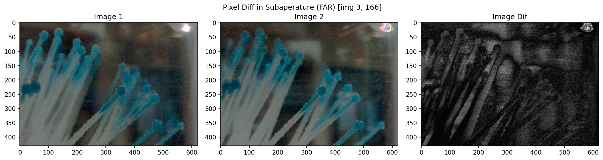
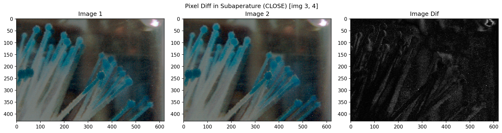
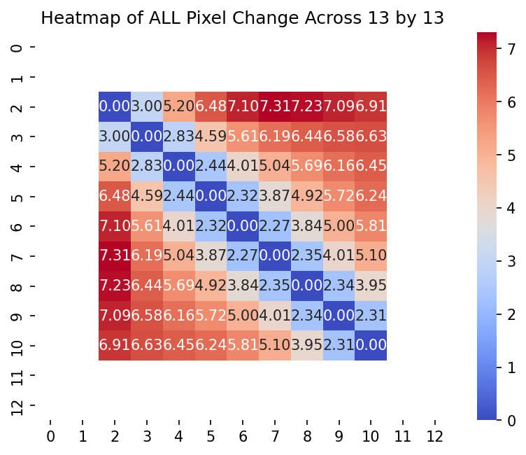

# Light Field Menu

## Brainstorming figures

- Correctly project single-image points in space without feature matching
    - maximize observations
        - Taking the top left subimage and bottom right subimage
        - Take four images, one at each corner
    - What subaperature/main lens does the depth map correlate to?
    - How to sample from depth map with sub-picture?
    - where are the mla baseline captured? 
    - Where is the subimage?


- Look for [non-Lambertian surfaces](https://en.wikipedia.org/wiki/Lambertian_reflectance) by sweeping across the sub-images. 
    - Mask random reflections/refractions
    - Pick and use the "correct color/texture"


- Feature extraction just for deformation node
    - What does edge detection across depths look like?
    - Combining edges to a 3d edge map
    - How to pick key features? Can we use existing algorithms?


- how does mediapipe  limb / linear asumption
- tatum robotics limbs


## 1. Working with sub aperatures

__Why: With a bigger range of subaperature, we can extract more information and see more "around" objects in the frame.__

I want to take four of the furthest subaperature in top/bottom left/right corner to form the most complete image. However, there might be distortion in the furthest edges, which will be hard to correct with epipolar geometry when matching to depth points. I want to investigate what each sub apearture looks like and highlight the "new" information observed.

https://github.com/hahnec/plenopticam/blob/24bb52377ae3a7d3c2db22981bdf87595dddf545/plenopticam/lfp_aligner/lfp_microlenses.py#L142-L148

The widest FOV is 13 by 13 images wide. For inputs higher than 13, it'll just be reduced. 
```bash
User size (21 px) is larger than micro image size and reduced to 13 pixels.
```

So using the 13 by 13 grid, I sampled and quantified the pixel differences between a set of images, testing sub aperatures that are closer and further apart. __We notice that subaperatures further apart result in a higher pixel change, giving us more information."__

For the far subaperatures:

- Percent Change: 5.649 %
- Mean Change: 14.404 px




For the close subaperatures:

- Percent Change: 2.826 %
- Mean Change: 7.207 px




Now, I wanted to see the change in pixels of different sub aperatures across the entire 13 by 13 grid. It makes sense that the diagonal represents and identical image and the corners of the heatmap show the pixel difference.




## 2. Extracting Key Points

__Why: My current approach is to map the key points of each tentacle to map across the different viewpoint/subaperature. The usage of the keypoints are to create a representative representation to make the deformation node. We don't need keypoints for feature matching within a single shot because of geometric knowledge.__