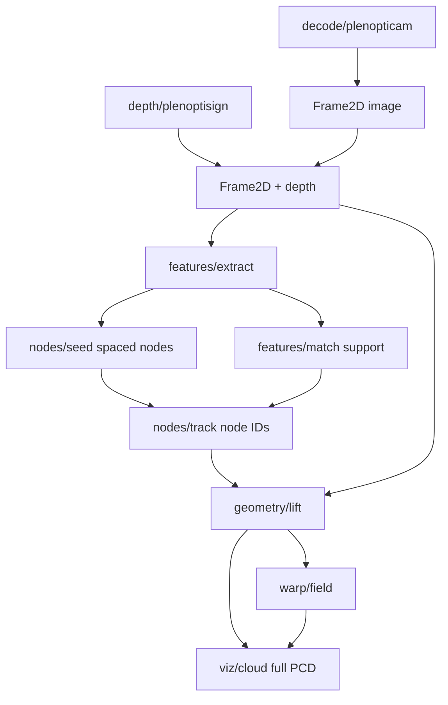

# Code structure: map current files into stages

Not one Python file per folder. Each folder is a **stage** with a small public API; files inside stay focused. Start by *moving/renaming what you already have*, leave warp/viz as thin stubs until you need them.

## Target layout (with your code mapped in)

```text
coral_reconstruction/
  types.py                 # shared dataclasses (new, small)
  pipeline.py              # wires stages; replaces LytroDepth.run glue

  decode/
    plenopticam.py         # ← PlenopticamLFR.py (class PlenopticamLFR)

  depth/
    plenoptisign.py        # ← PlenoptisignLFR.py (class PlenoptisignLFR)
    # optional later: stereo_depth.py if you add your own estimator

  features/
    extract.py             # ← preprocess, orb/sift, extract_features
    match.py               # ← match_features, ransac_filter
    depth_filter.py        # ← depth_at, filter_kp_by_depth, filter_matches_by_depth
    # keep show_* helpers here or move to viz/overlays_2d.py

  nodes/
    seed.py                # NEW: strong features → min-distance / FPS spaced nodes
    track.py               # NEW: match/track node IDs across frames (2D)

  geometry/
    lift.py                # NEW: (u,v,depth) → XYZ; build Open3D cloud for viz

  warp/
    field.py               # ← restore WarpField core: find_affected, apply_transform
                           #   (no interactive picking in the hot path)

  viz/
    cloud.py               # ← WarpField view/draw_sphere; full PCD + node spheres
    overlays_2d.py         # ← show_keypoints, show_matches (optional)

  scripts/                 # runnable demos, not library code
    decode_lfr.py          # ← PlenopticamLFR.__main__
    test_features.py       # ← utils/test_extract_features.main
    show_subaperture_grid.py  # ← utils/show_subaperture_grid.py

  utils/                   # shrink or delete once scripts/ exists
```

## What happens to each current file

| Current | Goes to |
|---------|---------|
| `PlenopticamLFR.py` | `decode/plenopticam.py` |
| `PlenoptisignLFR.py` | `depth/plenoptisign.py` |
| `LytroDepth.py` | retire as orchestrator → thin `pipeline.py` |
| `utils/test_extract_features.py` | split into `features/*` + `scripts/test_features.py` |
| `utils/show_subaperture_grid.py` | `scripts/show_subaperture_grid.py` |
| old `WarpField.py` (git history) | split: math → `warp/field.py`, viewer → `viz/cloud.py` |

## Stage contracts (so the pipeline works)

Keep types tiny and explicit in `types.py`:

- **`Frame2D`**: `image`, `depth_map`, `name`
- **`Features2D`**: `keypoints`, `descriptors`
- **`NodeSet2D`**: `node_id → (u, v)` plus optional descriptor for tracking
- **`NodeTrack`**: `node_id → positions per frame` (still 2D)
- **`Cloud3D`**: full point cloud + `node_id → xyz` after lift

Data flow:



**2D stays 2D through `nodes/track`.** Only `geometry/lift` creates 3D. Warp never sees raw images.

## How node matching fits

You do not need to decide “fit vs apply” yet. Structure for both:

1. `nodes/seed` — auto strong features + spacing (min distance / farthest-point)
2. `nodes/track` — correspondences **for those node IDs only** (use dense `features/match` as helper, filter to nodes)
3. `geometry/lift` — node 2D + depth → node XYZ; also build full cloud for viz
4. `warp/field` — given node XYZ at t and t+1, compute per-node Δ; propagate to nearby cloud points (Gaussian falloff from old WarpField)

If tracking fails for a node, drop or re-seed that ID — don’t let unmatched nodes drive the warp.

## What to do now vs later

**Now (organize only):** move decode/depth/features; add empty `nodes/`, `geometry/`, `warp/`, `viz/` with stub `run()` or docstrings; add `types.py` + `pipeline.py` that runs through feature matching.

**Next (implement):** `nodes/seed` + `nodes/track`, then lift + restore warp math, then viz.

## Import style

Prefer package imports once moved:

```python
from decode.plenopticam import PlenopticamLFR
from features.extract import extract_features
from features.match import match_features, ransac_filter
```

Keep each stage’s `__init__.py` exporting only the public functions/classes so `pipeline.py` stays short.

## Checklist

- [ ] Move `PlenopticamLFR` / `PlenoptisignLFR` into `decode/` and `depth/`
- [ ] Split `utils/test_extract_features.py` into `features/{extract,match,depth_filter}.py` + `scripts/test_features.py`
- [ ] Add `types.py` (`Frame2D`, `Features2D`, `NodeSet2D`, …) and thin `pipeline.py` replacing `LytroDepth` glue
- [ ] Add `nodes/`, `geometry/`, `warp/`, `viz/` stubs with clear I/O; restore WarpField math into `warp/field.py` and viewer into `viz/cloud.py` when ready
